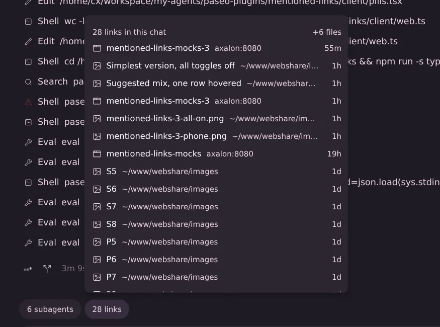
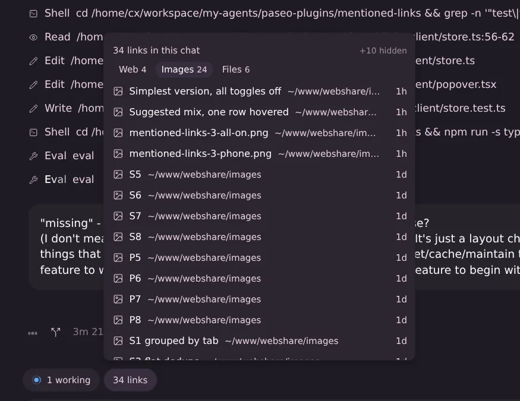

# Mentioned links

A **links** pill in each chat's composer, next to btw and the other pills. It counts every link that you and the agent mentioned in this chat, worded like Paseo's own pills (`6/6 tasks`, `5 subagents`): `6 links`, `1 link`, `0 links`, text only. Paseo requires an icon for plugin pills and keeps a 16 px slot for it; on web/desktop the plugin hides that slot, on the native apps it stays as a small blank gap. Open it for the list, newest mention first, one row per link: a type icon, the name, the host or folder in muted text, and how long ago it was last mentioned. On phones the list opens as a bottom sheet. The list scrolls inside the popover.

## Categories

Links are sorted by what a click does.

- **Web**: any http(s) URL, including GitHub, `http://axalon:8080/…` pages and localhost. Click opens it in the browser.
- **Images**: image URLs, and image files under `~/www/webshare/` (shown by their `http://axalon:8080/…` address). Click opens the image.
- **Files**: every other local path, including images outside the webshare. Click copies the absolute path, with the `:line` or `:a-b` suffix of its newest mention, and the row briefly says "copied".

**Type chips.** Under the header, one chip per type the chat has, with its count (`Web 4 · Images 24 · Files 6`); a type with no links gets no chip, and the chip row appears only when the chat has at least two types. One type shows at a time. By default that's **Web** (when the chat has web links; otherwise everything). The rest is counted in a tiny, faint **+30 hidden** at the right of the header; clicking it shows every link (all chips then read as on), clicking a chip shows only that type. The choice is kept per chat until the app reloads.

A webshare path and its `http://axalon:8080` URL are one row. Non-image files in the webshare (for example `~/www/webshare/pages/x.html`) are Web rows. The same path with different line suffixes is one row.

## What counts as a link

Only what you and the agent wrote in the chat: tool calls, tool output and sub-agents are left out.

- Image embeds ``, Markdown links `[text](…)`, autolinks `<https://…>`, bare http(s) URLs, and code spans holding exactly a URL or an absolute or `~/` path (with `:12`, `:12-20`, `:12:3` or `#L12-L20`).
- Fenced code blocks are skipped. Harness wrappers in user messages (`<system-notice>`, `<paseo-system>` and the like) and OMP `[ran …; recover: …]` records are removed first.
- Dropped: harness addresses (`artifact://`, `agent://`, `local://` and so on), placeholders containing `< > { } $ * …`, `example.com` hosts, relative paths, and paths whose top folder doesn't exist on the daemon machine (so `/btw` and `/v1/chat/completions` don't count). A code span path with spaces counts only if it exists.
- Names: the link text or image alt when there is one, else the file name or the URL's last path segment (`pull/12` for numbered ones).

## Where the data comes from

The plugin's daemon side reads each chat's transcript: OMP and its profiles (`omp-nilo`) through the session file Paseo stores, Claude Code from `~/.claude/projects/`, Codex from `~/.codex/sessions/` or `~/.codex/archived_sessions/`. The transcript is looked up again on every request (a rewind gives OMP a new file), and only the bytes appended since the last read are parsed. Chats of other providers, and Codex sessions archived only as `.jsonl.zst`, use Paseo's own chat history for that agent instead. That fetch is safe because the plugin only asks for chats whose pill is on screen, which Paseo has already loaded.

The count is fetched when a chat's pill first shows, again when that chat's agent finishes a turn, and when you open the list. While the list is open and the agent is working, it refreshes every 3 seconds. Nothing polls while agents are idle. A chat's first read takes about 15 ms for a 600 KB OMP transcript; later reads cost a file `stat` plus the new bytes.

## Limits

- Files can't open in Paseo's file viewer: plugins have no API for that yet, so a click copies the path.
- Images outside `~/www/webshare/` are Files (copy), since they have no URL.
- `localhost` URLs opened from a phone point at the phone.
- Mentions by sub-agents are not included.
- The webshare address (`http://axalon:8080`) is fixed in `server/links.ts`.

After editing the source, run `npm run typecheck` and `paseo plugin reload mentioned-links`.

## Proof (live web app, 2026-10-21, `screenshots/`)

- `desktop-dark.webp` (re-shot 2026-10-21 after the label change): the Links chat (index › Paseo Plugins), pill `28 links` next to Paseo's `6 subagents` with the same height, padding and font (32 px, 12 px, 13.3 px measured), no icon; popover with images, webshare pages and `+6 files`.
- The other screenshots predate the label change and show the old `links N` pill with an icon.
- `desktop-dark-files.webp`: files shown (`hide 5 files`): a `.md` file and folders mixed in by time. Clicking `paseo-grievances.md` put `/home/cx/agentspace/index/.scratch/paseo-grievances/paseo-grievances.md:318` on the clipboard and the row said "copied"; clicking the `mentioned-links-mocks` row opened `http://axalon:8080/pages/mentioned-links-mocks/` in a new tab and closed the popover.
- `desktop-light.webp`: the same popover in Paseo's light theme.
- `phone-dark.webp`, `phone-light.webp`: 390 px wide, the list as a bottom sheet.
- `empty-dark.webp`, `after-turn-dark.webp`: a throwaway Claude Code (Haiku) chat, deleted afterwards. Empty state first; a turn whose reply held a URL, a webshare image embed and a backticked file path turned the pill from `links` to `links 2` (with `+1 file`) about 4 seconds after sending, without reloading. A second turn with the list open added a GitHub row and `links 3` while the list stayed open.
