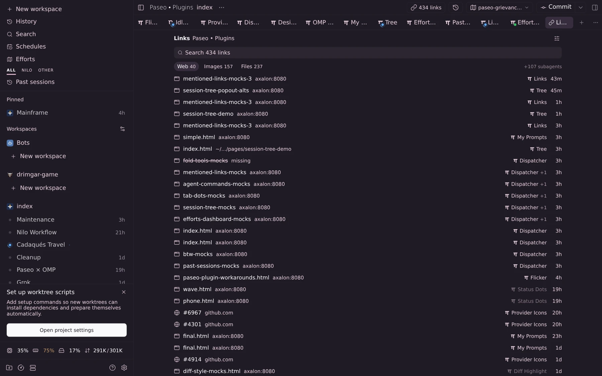
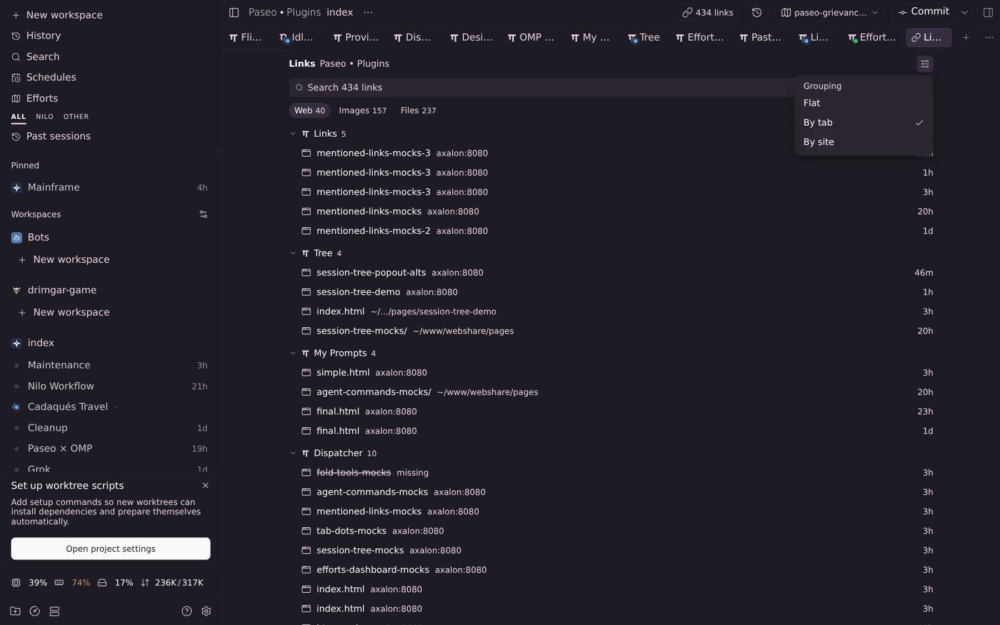
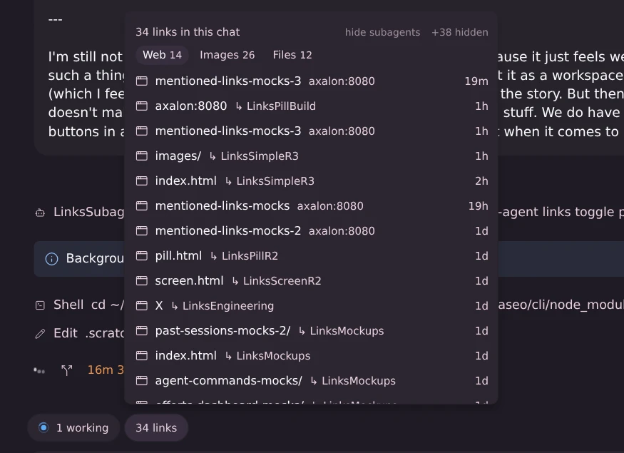
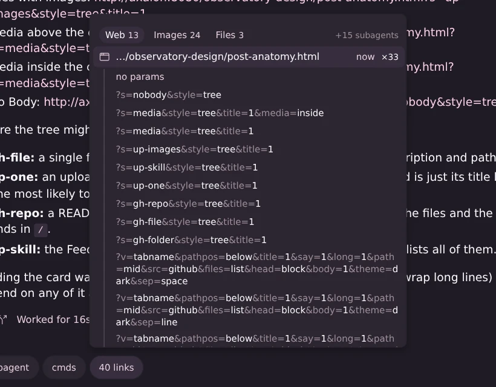
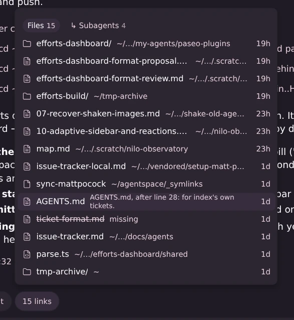

# Mentioned links

A **links** pill in each chat's composer, next to btw and the other pills. It counts every link that you and the agent mentioned in this chat, worded like Paseo's own pills (`6/6 tasks`, `5 subagents`): `6 links`, `1 link`, text only; a chat with no links shows no pill (it reads `links` for the moment before its count arrives). Paseo requires an icon for plugin pills and keeps a 16 px slot for it; on web/desktop the plugin hides that slot, on the native apps it stays as a small blank gap. Open it for the list, newest mention first, one row per link: a type icon and the link's path (see **Rows** below). The list has no title line: its only header is the type tabs and the sub-agents switch below, and without them the rows start at the top. On phones the list opens as a bottom sheet. The list scrolls inside the popover.

**Rows.** A row is the type icon and the link's path across the full width: URLs without their scheme, query and fragment (`axalon:8080/observatory-design/post-anatomy.html`, `github.com/getpaseo/paseo/pull/123`, a trailing `/` kept, a webshare `index.html` dropped), files as `~/…` paths with the `:line` suffix the click copies, folders ending in `/`. No link texts, image alts or separate host/folder column. A path that doesn't fit is shortened by measuring the row's width (on the web the browser measures the text exactly; the native apps estimate 0.6 em per character): the full path; then the first segment (host or `~`), `/…/` and the last two segments; then `…/` and the last two; then `…/` and the last segment, cut at the end with `…`. A shortened path has its full path as the web tooltip. After the path, in muted text: `missing` for a path that is gone, `↳ <sub-agent>` for a sub-agent's link. At rest the right edge is empty, except `×24` on rows with variants; hovering a row on desktop shows how long ago it was last mentioned there (next to `×24`); phones show no times. Clicking a row opens it (web and images) or copies it (files); a row with variants unfolds instead (see **Unfolding variants**).

## Workspace links page

An icon-only **link** button in each workspace's header (Lucide link icon, tooltip "Links in this workspace") opens that workspace's links as a tab in its main area, next to its chats. Paseo shows plugin header buttons on wide layouts only: from 1100 px it shows three plugin buttons, below that one plus a `⋯` overflow, and its phone layout (below 720 px) has no plugin header buttons at all, so on phones the page can't be opened yet (see Limits). Settings → Plugins → mentioned-links → **Mentioned links** (route `/settings/hosts/<server>/plugins/mentioned-links/header`) → **Show header button**: on by default; turning it off removes the button from every workspace header at once, without a reload; the composer pill stays.

The page (a workspace panel, `client/page.tsx`) is built from the popover's parts (`client/list-ui.tsx`): the same rows, type tabs and sub-agents switch.

- **Top:** `Links` and the workspace name in muted text, a muted settings button (sliders icon) at the right, a search field (`Search 434 links`), then the popover's **type tabs** (`Web 40 · Images 157 · Files 237`, same rules: only present types, only with 2+ types, opens on Web, one at a time, kept per workspace until the app reloads) and the right-aligned faint **`+107 subagents`** switch (only when sub-agents mention links that no tab of the workspace mentioned itself).
- **Search** matches every word against the shown path, the name, the folder or host, the URL or path, the sentence and the sub-agent. While searching, the tab counts are the matches per type; an empty result reads `No links match “…”` (plus `in images` when other types do match).
- **Settings menu:** one flat menu with settings under small muted headings; so far one heading, **Grouping**: **Flat** (default, checked), **By tab**, **By site**. The pick is kept per device (web: `localStorage`; the native apps keep it until the app reloads). On phones the menu is a bottom sheet.
- **Flat:** one row per link across the workspace: type icon · path (as in the popover) · the **tab** that mentioned it last, with that tab's provider mark (Paseo's built-in marks; Bot for others such as `omp-nilo`, and on the native apps) and a muted `+2` when two more tabs mention it too · on hover the time · `×N`. Clicking the tab name opens that tab (`navigation.openAgent`). Clicking the row does what the popover does: web and images open in the browser, files copy their path and the row says `copied`, rows with variants unfold. Missing files are struck through and marked `missing`.
- **By tab:** one group per tab with its count, open tabs first (newest link first), then a muted **Closed** separator and the closed tabs, which start folded. Rows have no tab column.
- **By site:** Flat's rows grouped by host (`github.com/<owner>/<repo>` for GitHub, `axalon:8080` for the webshare) or, for files, by folder; newest group first. Rows keep the tab column.
- Groups always fold (chevron, click the heading); the folding is kept per workspace until the app reloads.
- **Scope:** the workspace's tabs (Paseo's root agents, closed ones included). Sub-agents fold into their tab behind the `+N subagents` switch: the tab's OMP or Claude Code sub-agents and every Paseo agent below it in the same workspace. **Closed tabs** (archived agents) count like open ones; their name and provider mark are faint, and their name can't be clicked (Paseo opens no tab for an archived agent).
- **Empty states:** `No links in this workspace yet` with a one-line hint; `No links match “…”` for a search.

## Categories

Links are sorted by what a click does.

- **Web**: any http(s) URL, including GitHub, `http://axalon:8080/…` pages and localhost. Click opens it in the browser.
- **Images**: image URLs, and image files under `~/www/webshare/` (shown by their `http://axalon:8080/…` address). Click opens the image.
- **Files**: every other local path, including images outside the webshare. Click copies the absolute path, with the `:line` or `:a-b` suffix of its newest mention, and the row briefly says "copied".

**Type tabs.** The list's header is one tab per type the chat has, with its count (`Web 5 · Images 24 · Files 7`); a type with no links gets no tab, and tabs appear only when the chat has at least two types. One type shows at a time: tapping a tab shows that type and turns the others off. It opens on **Web** when the chat has web links, otherwise on its first type. The choice is kept per chat until the app reloads.

**One row per page.** A URL's row ignores its query string and fragment, the host's case, a default port and a trailing `/`; on the webshare `/dir/index.html` is `/dir/`. A webshare path and its `http://axalon:8080` URL are one row. Non-image files in the webshare (for example `~/www/webshare/pages/x.html`) are Web rows. The same path with different line suffixes is one row.

**Variants.** Each distinct full URL of a row (`?v=tree&title=1`, `?v=card&title=1`, `#install`, the bare URL) is kept as a variant with its link text, mention count and last time; the RPC sends them as `variants` (newest first) only when a row has two or more. On the links page, Flat and By site merge a page's variants across every tab (and shown sub-agent links): each distinct full URL once, counts summed, newest first; By tab shows each tab's own. For that, `links.for-workspace` sends the variants of every URL link, even a single one, and the page applies the two-or-more rule after merging. The server still names rows (`title`: one shared link text, else the page name), but the rows show only the path.

**Unfolding variants.** A row with variants shows a muted `×24` at its right edge: the number of distinct full URLs mentioned (the bare URL counts only if it was mentioned on its own). It is a count, not a button: clicking (tapping) anywhere on the row unfolds the variants under it as sub-rows on a faint rail, and clicking again folds them; such a row opens nothing itself. With the keyboard, Enter on the focused row toggles, → unfolds and ← folds. The fold is kept per row (per chat in the popover, per workspace and tab on the links page) until the app reloads. The sub-rows, on the same rules in the popover, the phone sheet and the links page (Flat, By tab, By site):

- **The bare URL first**, always, reading just `no params` in muted text: the variant without query or fragment when it was mentioned, else the newest variant's URL without them; a webshare `…/index.html` becomes `…/` there, as the row's key has it.
- **Then the other variants, newest first**, each as its literal query and fragment (`?v=tree3&pathpos=below&title=1&…&sep=space`, `#install`), wrapped in full so a difference at the end (`sep=…`) shows: no names, chips or summaries. The `?`, `&`, `=` and keys are the muted colour at 60% opacity, the values and the fragment the foreground colour, so the two stay apart even in T3 Chat Dark, where the muted colour is nearly white.
- The full URL is each sub-row's accessibility label and, on the web, its hover tooltip. Hovering a sub-row on desktop shows its last-mention time at the right edge; phones show none. Sub-rows are at least 24 px high on desktop and 36 px on phones.
- A click opens that exact URL in the browser and closes the popover.

**Sub-agent links.** When the chat's sub-agents mentioned links that the chat itself never did, a small text switch sits right-aligned in the header: **+18 subagents**, faint while off, full colour while on. It isn't a tab: switching it on merges those links into the list by time, each marked `↳ <sub-agent>` in muted text after its path, and they count in the type tabs like any other link; the pill keeps counting only the chat's own links. A link the chat also mentioned stays a plain row, so a chat with no sub-agents, or whose sub-agents only repeated its links, gets no switch. With only one type, the header holds just the switch. The choice is kept per chat until the app reloads.

Sub-agents are: OMP task sub-agents (`<session>/<Name>.jsonl`, nested ones and advisors included; named by file), Claude Code sub-agents (`<session>/subagents/agent-*.jsonl`; named by their task description), and Paseo child agents (label `paseo.parent-agent-id`, archived ones included; named by their title, read from their own transcripts, never through Paseo's history). The same rules as for the chat apply to their messages. When one link was mentioned by several sub-agents, the row names the one that mentioned it last.

**Missing files.** A path whose file or folder no longer exists on the daemon machine is marked: its path is muted and struck through, followed by a muted `missing` (`missing · ↳ Scout` for a sub-agent's). Webshare links count as paths here (their file under `~/www/webshare/` is checked); other web URLs are never checked. Every fetch checks each path with one `stat`. A click still copies the path, or opens the webshare URL.

**Sentences.** The server still cuts the sentence around each link's newest mention (`snippet`, used by the links page's search): Markdown stripped, every link read as its name, about 120 characters around the link; a link with too few words around it (`Saved in X.`) also gets the sentence before; an image embed on its own line gets its caption (the line under it in the same paragraph), else the line above. The rows no longer show it (until 2026-10-23, hovering a row on desktop swapped the host/folder column for it).

## What counts as a link

Only what you and the agent wrote in the chat: tool calls and tool output are left out. Sub-agents' messages are shown only on request (above).

- Image embeds ``, Markdown links `[text](…)`, autolinks `<https://…>`, bare http(s) URLs, and code spans holding exactly a URL or an absolute or `~/` path (with `:12`, `:12-20`, `:12:3` or `#L12-L20`).
- Fenced code blocks are skipped. Harness wrappers in user messages (`<system-notice>`, `<paseo-system>` and the like) and OMP `[ran …; recover: …]` records are removed first.
- Dropped: harness addresses (`artifact://`, `agent://`, `local://` and so on), placeholders containing `< > { } $ * …`, `example.com` hosts, relative paths, and paths whose top folder doesn't exist on the daemon machine (so `/btw` and `/v1/chat/completions` don't count). A code span path with spaces counts only if it exists.
- Names (the RPC's `title`, no longer shown on rows): the link text or image alt when there is one (see Variants for rows with several URLs), else the file name or the URL's last path segment (`pull/12` for numbered ones).

## Where the data comes from

The plugin's daemon side reads each chat's transcript: OMP and its profiles (`omp-nilo`) through the session file Paseo stores, Claude Code from `~/.claude/projects/`, Codex from `~/.codex/sessions/` or `~/.codex/archived_sessions/`. The transcript is looked up again on every request (a rewind gives OMP a new file), and only the bytes appended since the last read are parsed. Chats of other providers, and Codex sessions archived only as `.jsonl.zst`, use Paseo's own chat history for that agent instead. That fetch is safe because the plugin only asks for chats whose pill is on screen, which Paseo has already loaded.

The count is fetched when a chat's pill first shows, again when that chat's agent finishes a turn, and when you open the list. While the list is open and the agent is working, it refreshes every 3 seconds. Nothing polls while agents are idle. A chat's first read takes about 15 ms for a 600 KB OMP transcript; later reads cost a file `stat` plus the new bytes, plus one `stat` per path link for `missing`. Sentences are cut while the transcript is read and kept with each link, so a later fetch doesn't redo them.

Sub-agent transcripts are read only while the list is open (the pill never asks), with the same incremental cache, at most 16 files at a time. Measured on the Links chat (34–36 links; 8 OMP sub-agent transcripts, 6.8 MB; 18 extra links from 7 of them): the list's request took 54 ms the first time after a plugin reload (59 ms with sentences and `missing` checks) and 2–4 ms after that, against 1.5–2.5 ms without sub-agents. The Paseo child lookup costs about 1 ms. Old OMP sessions can hold hundreds of MB of sub-agent transcripts; such a chat's first open would take seconds [estimate from the 320 ms per 100 MB parse rate].

The links page asks `links.for-workspace` (`server/service.ts`): one `agents.list` (archived included, paged), Paseo's root rule (`server/workspace.ts`), then each tab's transcript through the same incremental cache, 16 at a time, and with the switch available each tab's sub-agent transcripts. It reads transcripts only, never Paseo's chat history, because most of a workspace's chats aren't loaded and a history fetch would start them; a tab of another provider lists no links. The page fetches when it becomes visible (switching to its tab, the app returning to the foreground) and every 3 seconds while any agent of the workspace is running; a hidden tab (Paseo keeps it mounted at width 0) fetches nothing. When one of the workspace's agents finishes a turn, is closed or is renamed while the page is on screen, it refetches; otherwise on the next show. The header button is icon-only and fetches nothing. Measured on index › Paseo Plugins (29 tabs, 17 of them closed, 34.8 MB of tab transcripts, 434 links, 107 more from sub-agents; machine load average 17): 0.5 s for the first request after a plugin reload (507 ms without sub-agents, 522 ms with them), then 18–28 ms without and 22–50 ms with sub-agents; the answer is 175 KB (226 KB with sub-agents).

## Limits

- Files can't open in Paseo's file viewer: plugins have no API for that yet, so a click copies the path.
- Images outside `~/www/webshare/` are Files (copy), since they have no URL.
- `localhost` URLs opened from a phone point at the phone.
- In the popover, sub-agents of Paseo child agents (grandchildren) are not included; OMP's own nested sub-agents are. The links page folds every Paseo agent below a tab into it.
- The links page needs the header button: Paseo's phone layout shows no plugin header buttons, and the page has no other entry (no sidebar row or ⌘K item, by design), so phones can only show a links tab already open in that workspace.
- A closed tab can't be opened from the page; reopening it is Paseo's History or the `past-sessions` plugin.
- The page lists no links for chats of providers without a readable transcript (anything but OMP, Claude Code and Codex).
- The webshare address (`http://axalon:8080`) is fixed in `server/links.ts`.

After editing the source, run `npm run typecheck` and `paseo plugin reload mentioned-links`.

## Proof (live web app, 2026-10-21, `screenshots/`)

- **Path rows, row-click unfold (2026-10-23)**, T3 Chat Dark, 1440 px and 390 px. `variants-dark.webp`: the nilo-observatory chat `f3046c55` (its agent was working, so `×24` grew to `×33` during the check). Rows read `axalon:8080/observatory-design/post-anatomy.html`, `nilo-observatory.vercel.app/post/2`, `github.com/…/productivity/grilling` (from `github.com/mattpocock/skills/tree/main/skills/productivity/grilling`), `github.com/…/grilling/SKILL.md`; Files `~/…/round2/post2-credit-title1-1280.png`; Images `axalon:8080/…/round2/…` and `…/round2/post2-credit-path-mid-long-1280.png`. No times at rest; hovering `post/2` showed `2h`, hovering the variants row showed `now ×33` (and the path one rung shorter while the time showed). Clicking the row unfolded it without opening anything (`window.open` stubbed: 0 calls); first sub-row `no params`, then the queries wrapped in full (`…&theme=dark&sep=space`, `…&sep=line`, `…&sep=none` on three lines each); syntax measured `rgba(231,208,221,0.6)`, values `rgb(249,248,251)`. A sub-row click opened exactly `…?v=card&pathpos=above&sep=line&title=1&files=list` and closed the popover; `no params` opened the bare URL; ← / → / Enter on the focused row folded and unfolded; reopening kept the fold. `phone-dark.webp` (re-shot): 390 px sheet, no times, `…/observatory-design/post-anatomy.html ×33` unfolded by a tap on the row, sub-rows 36 px (one line) and 56 px (three); a tapped variant opened its URL and the sheet closed. Links page of The Observatory: Flat (`…/share-previews/final/ ×6` unfolded to `no params` and 5 queries, hover time on a sub-row), By tab and By site unfolded too; grouping set back to Flat. `workspace-flat-dark.webp` (re-shot): the Paseo Plugins page, `axalon:8080/pages/…/` rows with their tab column, `×2`/`×5`/`×3` at the right edge, `axalon:8080/pages/fold-tools-mocks/` struck through with `missing`; `mentioned-links-mocks-3/` unfolded to `no params`, `?f=smenu`, `?f=search,closed,…`. Files showed `~/agentspace/index/.scratch/paseo-grievances/paseo-grievances.md:355-356` and copied `/home/cx/…:355-356` (`copied` at the right edge); with `+169 subagents` on, rows ended in `↳ LinksDedupe`, `↳ SleepPlugin07` (switched back off). The other screenshots predate these rows.
- First unfold version (2026-10-23, `×24` after the name as the button, name + host rows; its `variants-dark.webp` has since been re-shot): the nilo-observatory chat `f3046c55`, T3 Chat Dark, 1440 px. Clicking `×24` unfolded 24 sub-rows: `/observatory-design/post-anatomy.html` (mentioned, `1h`) first, then the 23 queries newest first, long ones cut after two lines; the values measured `rgb(249,248,251)` (foreground) against `rgb(231,208,221)` (this theme's muted, so the difference is small here), the full URL as each sub-row's `title`. A sub-row click opened exactly `…?v=card&pathpos=above&sep=line&title=1&files=list` and closed the popover; the bare row opened the bare URL; the row click still opened the newest (`…&sep=space`); clicking `×24` again folded without opening anything; ← / → on the focused row folded and unfolded; reopening the popover kept the fold. At 390 px the sheet's `×24` unfolded on a tap 8 px above it; sub-rows measured 36 px (one line) and 40 px (two lines), and a tapped variant opened its URL and closed the sheet. On the workspace's Links page, Flat (`final ×6`: its mentioned `…/final/index.html` first), By tab (`post-anatomy.html`, queries on one line at that width) and By site all unfolded; the grouping was set back to Flat.
- `dedupe-dark.webp` (2026-10-23): the nilo-observatory chat `f3046c55` (The Observatory). Its 24 distinct `post-anatomy.html` URLs (`?v=now&title=1`, `?v=tree3&pathpos=below&…&sep=space`, the bare URL …) were 24 rows, 11 of them identical-looking `post-anatomy.html axalon:8080` and the rest named `now`, `card`, `tree`, `tree2` … They are now one row, `post-anatomy.html axalon:8080 ×24`, whose click target is the `…&sep=space` URL the agent sent last. The chat went from 63 rows (Web 36) to 40 (Web 13), the pill reads `40 links`. On the Paseo Plugins links page, searching `mocks-3` showed one `mentioned-links-mocks-3 axalon:8080 ×3` row for the `?f=` URLs.
- `desktop-dark.webp` (re-shot 2026-10-21 after the label change): the Links chat (index › Paseo Plugins), pill `28 links` next to Paseo's `6 subagents` with the same height, padding and font (32 px, 12 px, 13.3 px measured), no icon; popover with images, webshare pages and `+6 files`.
- The other screenshots predate the label change and show the old `links N` pill with an icon; the `types-*.webp` ones also show the old one-type-at-a-time chips with a `+N hidden` label and a `N links in this chat` title, both gone since 2026-10-21.
- **Workspace page (2026-10-21)**, index › Paseo Plugins, desktop 1440 px and 390 px, T3 Chat Dark and Light themes:
  - `header-button.webp` (re-shot after the button became icon-only): the link icon, first of the plugin header buttons, next to History and the Efforts pill; clicking it opened the Links tab for that workspace. At 800 px it is the one visible plugin button (the others in `⋯`); at 700 px and 390 px Paseo shows no plugin header buttons.
  - **Show header button** off removed the button from the header, on brought it back, both without reloading the app (same document, checked); left on.
  - `workspace-flat-dark.webp` (re-shot 2026-10-23, see above; this paragraph describes the original): Flat by default, rows naming their tab (`Dispatcher +1`), closed tabs faint (`Status Dots`, `Diff Highlight`), `fold-tools-mocks` struck through as `missing`; hovering `session-tree-popout-alts` showed its sentence. Clicking the tab name `Tree` opened the Tree tab; `Status Dots` (closed) is not clickable since `openAgent` did nothing for it. A Files row copied its path and said `copied`.
  - `workspace-by-tab-menu-dark.webp`: the settings menu with Grouping (By tab checked). By tab showed the open tabs, then `Closed` with 17 folded closed tabs; `Status Dots` unfolded to its 3 links and `Flicker` folded away. By site grouped files by folder (`~/…/.scratch/paseo-grievances 28`, `paseo-grievances.md` named `Links +18`). The grouping survived an app reload.
  - `+107 subagents` turned Web 40 → 53 and the field to `Search 541 links`, with rows such as `images/ ↳ AgentCmdsFinalMock`. Searching `efforts mocks-4` left 2 rows (Web 2, Images 0, Files 0); the Images tab then read `No links match “efforts mocks-4”`.
  - `workspace-phone.webp`: 390 px, one-line rows with name, folder, tab and time; the settings menu opened as a bottom sheet. The light theme was checked on desktop (rows, search field, menu).
- `desktop-dark-files.webp`: files shown (`hide 5 files`): a `.md` file and folders mixed in by time. Clicking `paseo-grievances.md` put `/home/cx/agentspace/index/.scratch/paseo-grievances/paseo-grievances.md:318` on the clipboard and the row said "copied"; clicking the `mentioned-links-mocks` row opened `http://axalon:8080/pages/mentioned-links-mocks/` in a new tab and closed the popover.
- `desktop-light.webp`: the same popover in Paseo's light theme.
- `phone-dark.webp` (re-shot 2026-10-23, see above), `phone-light.webp`: 390 px wide, the list as a bottom sheet.
- `empty-dark.webp`, `after-turn-dark.webp`: a throwaway Claude Code (Haiku) chat, deleted afterwards. Empty state first; a turn whose reply held a URL, a webshare image embed and a backticked file path turned the pill from `links` to `links 2` (with `+1 file`) about 4 seconds after sending, without reloading. A second turn with the list open added a GitHub row and `links 3` while the list stayed open.
- First sub-agent version (2026-10-21; its `subagents-dark.webp` has since been re-shot): the Links chat with 7 OMP sub-agents. The header read `+18 from subagents` next to `+30 hidden`; after a click, Web went from 4 to 14 with rows such as `pill.html ↳ LinksPillR2` between the chat's own, the pill stayed `34 links`, and the choice survived closing and reopening the list. The Dispatcher chat (no sub-agents) showed no label. Over the RPC, the Grill chat with 9 Paseo children gave 6 extra links (`↳ Grill: …`) and two Claude Code chats in nilo-observatory and nilo-wayfinder gave 7 each, named by task description.
- `subagents-dark.webp` (re-shot 2026-10-21, tabs + switch): the Links chat with Web selected and `↳ subagents 18` on at the right edge; Web read 15, rows marked `↳ LinksPillR2` and so on, and the sub-agent link `http://axalon:8080/X` (no such file) struck through as `missing · ↳ LinksEngineering`. Checked live: Images then Files each lit only their own tab (Files showed 13 rows with sub-agents, 7 without); the switch turned faint and the counts dropped back (Web 5 · Images 24 · Files 7) when switched off.
- `missing-dark.webp`: the Parser chat (only files, plus 4 sub-agent links) showed `Files 15` and `↳ Subagents 4`; tapping `Files` did nothing. `ticket-format.md` (deleted since) is struck through as `missing`; hovering `AGENTS.md` showed its sentence. The OMP Commands chat (4 files, no sub-agents) showed no chip row, rows from the top, and `paseo-btw-test` as `missing` (the agent had deleted that folder); clicking it put `/home/cx/tmp-archive/paseo-btw-test` on the clipboard. A second copy click in the same headless tab got "Couldn't copy the path" from the browser's clipboard, not from the plugin.
