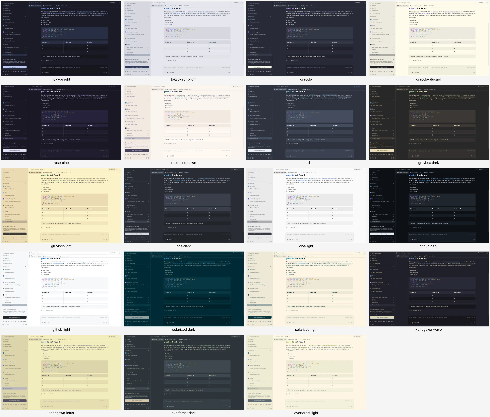

# Popular themes

Adds 19 app themes to **Settings → Appearance → Theme**: Tokyo Night and Tokyo Night Light,
Dracula and Dracula Alucard, Rosé Pine and Rosé Pine Dawn, Nord, Gruvbox Dark/Light,
One Dark/Light, GitHub Dark/Light, Solarized Dark/Light, Kanagawa Wave/Lotus, Everforest Dark/Light.
Client-only: no server code, no DOM edits. Installing changes nothing until you pick a theme.

Full size: [Tokyo Night](screenshots/tokyo-night.webp), [Tokyo Night Light](screenshots/tokyo-night-light.webp).

## Removing a theme

Every theme is one self-contained `// Name { … }` block in `index.client.ts`. Delete the block,
then `paseo plugin reload popular-themes` and refresh the app. If the removed theme was selected,
Paseo falls back to its default, so pick another theme first.

## How Paseo uses the eight colors

Paseo's theme API takes eight colors and expands them into the whole app. Knowing where each one
lands is what makes a port feel right (from the installed 0.11.4 bundle; unchanged in 0.12.0):

| Token | Where it shows up |
|---|---|
| `background` | chat area, dark-theme sidebar, terminal, accent-button text |
| `raised` | sidebar hover (dark), blockquotes, cards |
| `control` | code blocks, table headers, inputs, menus, selected row (dark), **whole sidebar (light)** |
| `border` | dividers and outlines, control hover, sidebar hover (light) |
| `accent` | links, inline code in headings, filled buttons, success state |
| `mutedForeground` | secondary text, the most used text color in the app |
| `ring` | timestamps, composer placeholder, section labels, focus rings, usage meter, **selected sidebar row (light)** |

So each theme maps: `background` = editor background; `control` = the theme's own highlight or
sidebar swatch; `border` = next step on its neutral ladder; `accent` = its signature color;
`mutedForeground` = its secondary text; `ring` = its comment/gutter tone.

**Light-theme compromise.** In light themes `ring` is both the faintest text and the selected
sidebar row's fill, which carries primary text. One color can't be both a readable label and a
background for dark text. `ring` is set to the darkest tone that keeps primary text on the selected
row at about 5:1 (about 2:1 against the background). Timestamps, placeholder and section labels are
therefore faint in light themes, faintest in Kanagawa Lotus and Everforest Light, whose mid-tone
foregrounds leave the least room.

## Sources and derived colors

Colors are the originals' own hex values unless the code comment on that line says `derived`
(a straight sRGB mix of two of the theme's own swatches, used where the original has no color for
that role).

| Theme | Source |
|---|---|
| Tokyo Night / Light | [enkia VS Code themes](https://github.com/enkia/tokyo-night-vscode-theme/tree/master/themes); ring = [folke](https://github.com/folke/tokyonight.nvim) `dark5` |
| Dracula / Alucard | [Dracula spec](https://draculatheme.com/spec): classic, Alucard and UI background ladders |
| Rosé Pine / Dawn | [rose-pine palette.lua](https://github.com/rose-pine/neovim/blob/main/lua/rose-pine/palette.lua) |
| Nord | [nord.css](https://github.com/nordtheme/nord/blob/develop/src/nord.css) |
| Gruvbox | [morhetz/gruvbox](https://github.com/morhetz/gruvbox/blob/master/colors/gruvbox.vim), medium contrast; aqua accent in both |
| One Dark / Light | Atom [one-dark-ui](https://github.com/atom/one-dark-ui) / [one-light-ui](https://github.com/atom/one-light-ui) and syntax; dark ring = One Dark Pro comment |
| GitHub | [Primer](https://primer.style/foundations/primitives/color) dark/light default |
| Solarized | [altercation/solarized](https://github.com/altercation/solarized); dark raised = VS Code Solarized sidebar `#00212b` |
| Kanagawa Wave / Lotus | [kanagawa.nvim colors.lua](https://github.com/rebelot/kanagawa.nvim/blob/master/lua/kanagawa/colors.lua) |
| Everforest | [everforest.vim](https://github.com/sainnhe/everforest/blob/master/autoload/everforest.vim), medium |

Things the API can't set keep Paseo's defaults: error red, warning/status colors, diff colors,
terminal ANSI colors and code syntax (pick a syntax theme separately in Appearance). The menu
swatch is always the theme's background.

## Contrast

WCAG ratios. Text columns are the worst case over `background`, `raised` and `control`.

| Theme | Text | Muted | Accent | Ring on bg | Text on selected row |
|---|---:|---:|---:|---:|---:|
| Tokyo Night | 8.3 | 6.4 | 6.8 | 4.1 | — |
| Tokyo Night Light | 7.7 | 5.4 | 5.5 | 1.8 | 5.1 |
| Dracula | 11.1 | 5.8 | 5.9 | 3.0 | — |
| Dracula Alucard | 13.6 | 4.7 | 6.0 | 2.2 | 7.1 |
| Rosé Pine | 11.5 | 4.7 | 8.4 | 3.4 | — |
| Rosé Pine Dawn | 7.9 | 4.6 | 5.6 | 1.8 | 4.9 |
| Nord | 7.5 | 6.4 | 6.2 | 3.1 | — |
| Gruvbox Dark | 8.5 | 5.3 | 7.0 | 4.0 | — |
| Gruvbox Light | 8.5 | 4.7 | 4.4 | 1.9 | 5.3 |
| One Dark | 7.5 | 4.9 | 5.9 | 3.7 | — |
| One Light | 9.4 | 4.4 | 3.9 | 2.2 | 5.0 |
| GitHub Dark | 12.9 | 4.9 | 7.5 | 4.1 | — |
| GitHub Light | 14.8 | 5.7 | 5.2 | 2.0 | 7.9 |
| Solarized Dark | 4.9 | 4.1 | 4.1 | 2.8 | — |
| Solarized Light | 10.6 | 4.4 | 3.4 | 2.2 | 5.4 |
| Kanagawa Wave | 9.7 | 7.7 | 5.9 | 3.3 | — |
| Kanagawa Lotus | 5.0 | 3.9 | 4.6 | 1.6 | 3.8 |
| Everforest Dark | 5.6 | 4.3 | 6.2 | 3.2 | — |
| Everforest Light | 4.7 | 3.5 | 3.3 | 1.5 | 3.6 |

Solarized, Kanagawa Lotus and Everforest Light are low-contrast by design; their numbers reflect
the originals, not a mapping error. Accents of 3–4:1 (One Light blue, Solarized blue, Everforest
Light green) are kept for identity.

## Live check (2026-10-19)

All 19 themes, plus both T3 themes, were selected in an isolated headless browser on
`app.paseo.sh` against the local 0.11.4 daemon and screenshotted on a chat with a shell call,
inline code, link, list, code block, table and blockquote. One switch went through the real menu
(Gruvbox Dark, then back to **System**). Theme choice is stored per browser, so Stefan's own apps
were never touched.
