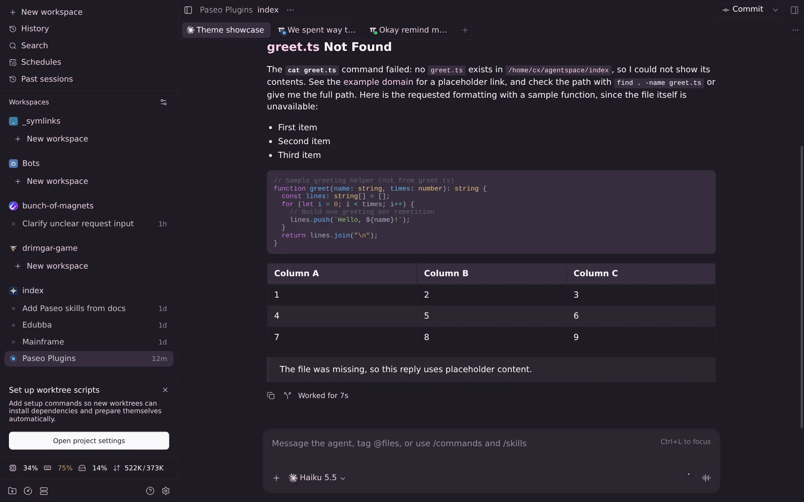
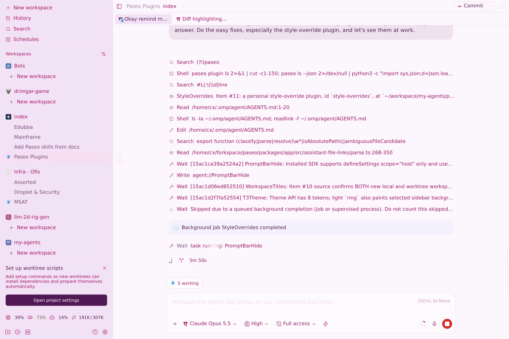

# T3 Chat theme

Adds **T3 Chat Dark** and **T3 Chat Light** to **Settings → Appearance → Theme**. Client-only:
no server code, no DOM edits. Installing changes nothing until you pick one. Disable with
`paseo plugin disable t3-chat-theme`.

| Dark | Light |
|---|---|
|  |  |

## Palette

From `T3_CHAT_THEME` in T3 Code's
[themePalettes.ts](https://github.com/pingdotgg/t3code/blob/1451e7cb23034d29774338608368a15d8845df36/packages/shared/src/themePalettes.ts#L246-L395)
(light `colors`, dark `variants.dark`), converted from OKLCH to hex because Paseo accepts only hex.

| Paseo token | Light | Dark |
|---|---|---|
| background | canvas | canvas |
| foreground | text | text |
| raised | surfaceRaised | surfaceRaised |
| control | sidebar | secondary |
| border | border | border |
| accent | messageActionHover | accentForeground |
| mutedForeground | textMuted | textMuted |
| ring | muted | placeholder |

Why these choices (where each token lands in Paseo is in `../popular-themes/OVERVIEW.md`):

- Paseo writes accent-button text in the background color. T3's deep-pink dark accent would put
  dark text on dark pink, so dark uses T3's pale pink action text as the accent instead. Light uses
  the darker hover pink, which keeps white-ish text readable.
- `ring` is Paseo's faintest text (timestamps, placeholder, section labels). Dark uses T3's own
  placeholder color, which sits below the muted text as it should.
- In light themes `ring` is also the selected sidebar row's fill, so it can't be both a readable
  label and a background for dark text. Light uses T3's `muted` pink: the selected row reads at
  6.8:1, at the cost of faint timestamps and labels (1.8:1).

Error red, warnings, diff and terminal colors, syntax highlighting and T3's sidebar artwork can't
be set through the API and keep Paseo's defaults.

## Contrast

WCAG ratios; text columns are the worst case over background, raised and control.

| Variant | Text | Muted | Accent | Ring on bg | Text on selected row |
|---|---:|---:|---:|---:|---:|
| Dark | 12.4 | 9.0 | 12.4 | 5.4 | — |
| Light | 10.5 | 5.5 | 5.4 | 1.8 | 6.8 |

## Live check (2026-10-19)

Both variants selected in an isolated headless browser on `app.paseo.sh` against the local daemon,
screenshots above. Theme choice is stored per browser; Stefan's apps were not touched.
