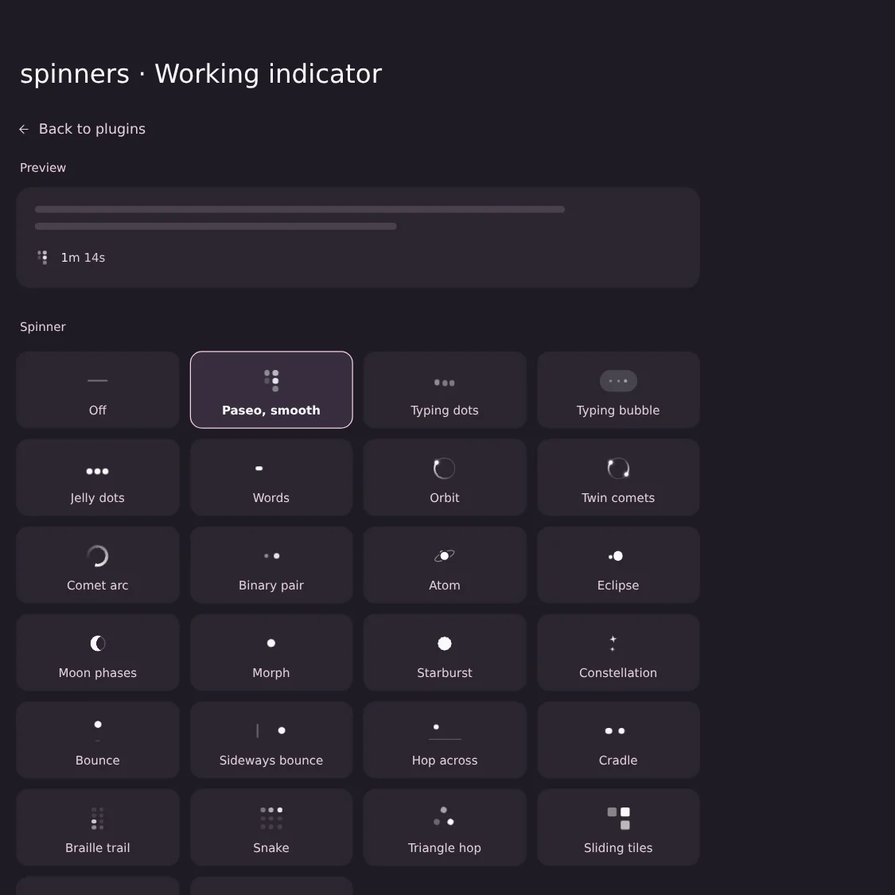
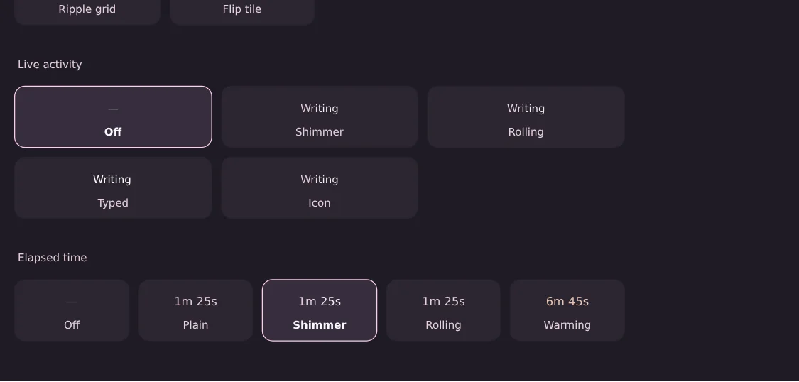
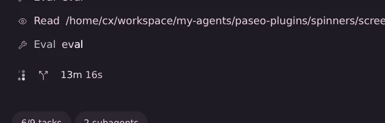
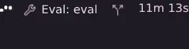
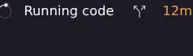

# Working indicator (`turn-status`)

Replaces what Paseo shows at the bottom of a turn while an agent works. Three separate settings,
each with its own "Off":

| Setting | Choices | Default |
| --- | --- | --- |
| Spinner | Off, Paseo smooth, Typing dots, Typing bubble, Jelly dots, Words, Orbit, Twin comets, Comet arc, Binary pair, Atom, Eclipse, Moon phases, Morph, Starburst, Constellation, Bounce, Sideways bounce, Hop across, Cradle, Braille trail, Snake, Triangle hop, Sliding tiles, Ripple grid, Flip tile | Paseo smooth |
| Live activity | Off, Shimmer, Rolling, Typed, Icon | Off |
| Elapsed time | Off, Plain, Shimmer, Rolling, Warming | Shimmer |

"Paseo smooth" is Paseo's own 2×3 dot grid with the same six frames, faded instead of stepped
(Paseo's steps at about 6 fps). Live activity shows what the agent is doing right now ("Reading
overrides.ts", "Running git status", "Thinking", "Writing"), read from the newest tool row of that
turn; "Icon" puts the tool's own Paseo icon inside the same shimmer. "Warming" hides the time for the
first minute, fades it in up to 5 min, then turns it amber and, by 15 min, red.

Web and desktop apps only. The native phone apps keep Paseo's own indicator.

**Settings:** ⌘K → "Working indicator settings", or Settings → Plugins → Working indicator. Every
choice is a live, clickable tile; the preview at the top shows the three settings combined, as in a
real turn. Saved per host; other open windows pick it up on focus.

| Settings | | Footer |
| --- | --- | --- |
|  |  |    |

## How it works (for agents)

- `shared/preferences.ts`: the settings document (`indicator`), the picker order and names.
- `client/catalog.ts`: all CSS (every spinner is pure CSS sized in em, class/keyframe prefix `spn-`)
  and each spinner's markup. Add a spinner: one entry in `SPINNERS` + `SPINNER_NAMES`, one in
  `SPINNER_MARKUP`, its CSS here.
- `client/web.ts`: the DOM side. `startIndicator()` watches the page and restyles every
  `[data-testid="turn-working-indicator"]`: hides Paseo's loader (first child of the footer's content
  row) and puts ours in the same wrapper, inserts the live label after it, and styles
  `[data-testid="turn-working-elapsed"]` (warming) or hides it behind our own copy (shimmer, rolling). The live label reads the newest
  `[data-history-row-id]` row of the same `[data-testid="agent-chat-scroll"]`
  (`tool-call-badge`/`tool-call-group` name + summary + icon). The same controllers drive the
  settings demos.
- `client/settings.tsx`: the settings screen (React Native tiles with empty spans the web module fills).
- Elements it adds carry `data-spn-own`, so their own animations never wake the page observer.
  Disabling the plugin puts every footer back exactly as Paseo drew it.

Apply edits: `flock /tmp/paseo-plugin.lock paseo plugin reload turn-status`. Checks: `npm run typecheck`, `npm test`
(`client/web.test.ts`, vitest + jsdom).

## Runtime cost (applied 2026-10-21)

Every animation should run on the compositor (only `transform` and `opacity` change), so a running
turn in view costs the page's main thread nothing between steps. Measurements and reasoning:
`~/agentspace/index/.scratch/paseo-grievances/runtime-cost-fix-advice.md` §2.5.

- **Warming** steps every 10 s with no transition (`warmth()` in `client/web.ts`). It used a 1 s
  `color`/`opacity` transition re-aimed by every 1 s elapsed-text update, i.e. a main-thread
  animation running for the whole 1–15 min ramp. A 10 s step moves at most 5 % opacity or a
  thirtieth of the colour blend.
- The footer writes `data-spn-spinner`, `data-spn-time` and the warming variables only when their
  value changes (each write restyles the footer).
- **Shimmer** (time style, live styles shimmer/rolling/icon) is a sheen built from transforms
  (`addSheen`/`SheenText` in `client/web.ts`, `.spn-gl` in `client/catalog.ts`): muted text, and
  over it a bright copy seen through a window whose static mask is the band. The window slides
  right while the copy inside slides left by the same amount, so the glyphs stay put and only the
  band moves. It replaced a `background-position` animation on `background-clip: text`, which
  repainted on the main thread every frame while a turn was in view. Same 100° band, 300 % width
  and 1.8 s sweep as before. The shimmer time style now hides Paseo's elapsed text and shows our
  copy in the same font (as rolling always did); the icon style's one band covers icon and text.
- **Spinners** that animated main-thread properties now use transform/opacity only, same look:
  binary pair drops its `z-index` keyframes (both dots are one colour, so stacking never showed);
  atom and eclipse draw the orbiting body twice, under and over the centre body, and swap the two
  with step-end opacity where the `z-index` used to flip (`depthSwap()`); moon phases slides the
  masked element and counter-slides the moon inside it (the old `mask-position` sweep); morph
  (`border-radius`) and starburst (`clip-path`) spin a wrapper and change shape as a flipbook of
  pre-drawn copies, one shown per slot by step-end opacity (`flipbook()`: 48 and 66 slots per cycle,
  about 30 shape steps a second, sampled with the old easing; rotation stays continuous). Rolling
  time digits slide by `transform` instead of `margin-top`.
- `client/web.test.ts` checks that the injected CSS animates and transitions nothing but
  `transform` and `opacity`; `client/catalog.test.ts` that each flipbook and depth swap shows
  exactly one copy at every moment.

## Limits

- Depends on Paseo 0.12's test IDs and footer layout (`turn-working-indicator`, `turn-working-elapsed`,
  `agent-chat-scroll`, `data-history-row-id`, `tool-call-badge`). If an upgrade changes them, the
  footer falls back to Paseo's own look; nothing breaks.
- Live activity: very fast tools (about 200 ms) only show as the label that follows them; in Paseo's
  "Overview" tool display it shows the group summary ("Read 3 files, ran 2 commands"). Codex reads
  files through the shell, so it shows "Running cat". Feasibility study:
  `~/agentspace/index/.scratch/paseo-grievances/live-activity-feasibility.md`.
- Warming colours are fixed amber/red tones (dark and light variants), not theme tokens.

## Live proof (2026-10-20, Paseo 0.12.0 daemon + app.paseo.sh, dark theme)

Installed from this folder; tested on a real running OMP turn in the web app:

- Defaults: Paseo's loader hidden, our smooth grid in its place (14 px), elapsed time shimmering.
- Picking tiles in the settings screen updated the running turn's footer immediately: Jelly dots +
  Icon label ("Running code" with omp's Eval icon) + Rolling time; then Orbit + Typed + Warming
  (amber at 12 min).
- `paseo plugin disable` removed every added element and style live (Paseo's dots back);
  `enable` restored ours. Settings were set back to the defaults afterwards.

Design history (mock pages, picks, research): `~/www/webshare/pages/paseo-spinners.html`,
`~/agentspace/index/.scratch/paseo-grievances/working-indicator-research.md`.
